 

## Hi, I'm Samhita

I'm a second-year CSE student building **Edit Theory**, an AI automation practice for D2C brands and local businesses. I ship systems that run on free-tier infrastructure, and I write down what broke while building them.

Most automation work is invisible. A workflow hums in the background and only its owner ever sees it. I try to build the ones that have a front door, and to be upfront about which parts are live and which are simulated.

## Start here

**[Edit Theory Concierge](https://github.com/Samhita1008/edit-theory-concierge)**  
A customer-facing booking assistant for local businesses. Pick a category, search in plain language, book, and watch a live status screen resolve to a real confirmation email. Runs in disclosed demo mode with two production integrations built and swap-ready.  
[Live demo](https://edit-theory-concierge-s6ra.vercel.app) · [Backend case study](https://github.com/Samhita1008/edit-theory-agents/tree/main/6-edit-theory-concierge)

**[RWA Complaint and Vendor Coordination Agent](https://github.com/Samhita1008/rwa-complaint-agent)**  
Runs the complaint-to-resolution loop for an apartment society over Telegram. The AI drafts, the secretary approves everything that leaves the building.

**[edit-theory-agents](https://github.com/Samhita1008/edit-theory-agents)**  
The full set of eight n8n agents, each with a pipeline, a stack and engineering notes. Four publish their workflow JSON so you can import and run them, including the newest, [Contract Redlining](https://github.com/Samhita1008/edit-theory-agents/tree/main/8-contract-redlining-agent).

**[edittheory-portfolio](https://github.com/Samhita1008/edittheory-portfolio)**  
The source of my [portfolio site](https://edittheory-portfolio.vercel.app/): a scroll-driven case-study site that opens by zooming into the letter T of the logo.

**[websites-portfolio](https://github.com/Samhita1008/websites-portfolio)**  
Eleven concept websites for local brands, built as working demos.

## How I build

- **Say what's real.** If a part is simulated, the README and the UI say so.
- **Document the bugs.** Every project has engineering notes: what failed, why, and the fix.
- **Humans approve outbound.** Anything that emails, messages or posts on someone's behalf waits for a person.
- **Build portable.** One config node per workflow, so a system built for one business can be handed to the next.

## Toolbox

## Now

- Taking Concierge from demo to a real restaurant partner
- Finding a real society secretary to pilot the RWA agent
- Exploring packaging the Restaurant Outreach system as a product

---

`sudo make ideas real ;)`

